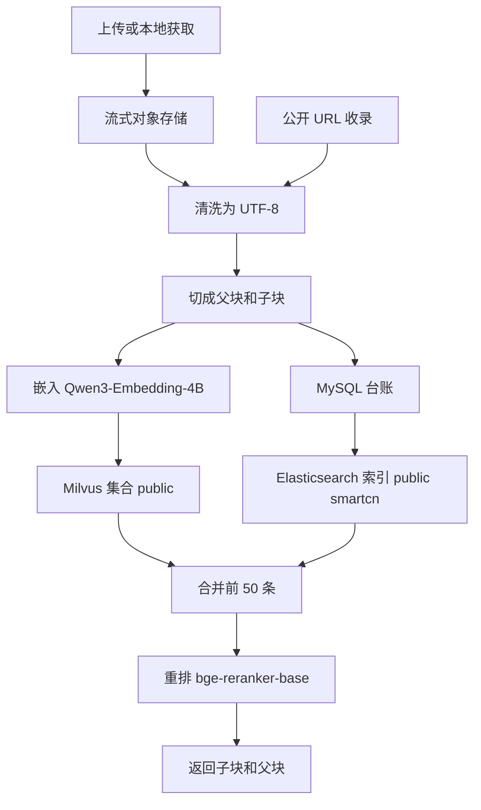

# urag

urag 是独立的检索程序。它把公开来源收成可检索的集合，回答时返回命中的子块和父块。它不是聊天机器人，也不读取其他项目的业务数据。

## 功能

- 上传或按 URL 获取材料。公开收录只留下源地址和清洗后的 UTF-8，不把原文写入对象存储。
- 清洗得到正文，再切成父块和子块。台账在 MySQL，表是 `source_document`、`parent_section`、`child_chunk`。
- 用 `Qwen/Qwen3-Embedding-4B` 做 2560 维嵌入，写入 Milvus 集合 `public`。
- 用 Elasticsearch 索引 `public` 做中文 BM25。分析器是 smartcn。
- 向量和 BM25 合并后，用 `BAAI/bge-reranker-base` 重排。这个权重的 config 底座名是 `xlm-roberta-base`，目录名保持 `bge-reranker-base`。
- `urag try` 打开试查页。`urag serve` 打开验收页。`urag search` 在点名集合里检索。

## 部署

需要 Docker、Go 1.22 和 Python 3（已安装 `huggingface_hub`）。密钥只放在环境变量里。`.env.example` 里的值都是假的，不要把它当成可连接的配置。

一键拉起依赖、初始化并测试：

```bash
./scripts/bootstrap.sh
```

这条命令会：

1. 复用已有容器 `urag-mysql`、`urag-milvus`、`urag-elastic`。没有容器时才创建。不删除数据，不停止其他容器，不启动收录。
2. 运行 `scripts/init-models.py`，下载并校验 `Qwen3-Embedding-4B` 和 `bge-reranker-base`。
3. 运行 `scripts/init-db.sh`，执行 `internal/catalog/schema.sql`，并写入可重复的检索夹具。
4. 运行 `scripts/init-es.sh`，在缺索引时创建索引 `public`（smartcn、BM25），并写入同一份夹具。已有索引不重建。
5. 运行 `go test ./...`。

模型目录：

| 变量 | 未设置时的目录 |
| --- | --- |
| `URAG_EMBED_MODEL_DIR` | `~/.cache/urag-models/Qwen3-Embedding-4B` |
| `URAG_RERANK_MODEL_DIR` | `~/.cache/urag-models/bge-reranker-base` |

本机已有文件且校验通过时不会重下。权重留在本机，不进 git。

数据库使用 `URAG_MYSQL_DSN`。未设置时，新建容器需要 `URAG_MYSQL_ROOT_PASSWORD`；如果容器 `urag-mysql` 已在运行，初始化会使用该容器自己的口令文件，不把口令写进仓库。默认库名是 `urag`。夹具来源以 `fixture://urag/` 开头，重复执行只替换这几行。

Elasticsearch 使用 `URAG_ELASTIC_ADDR`，未设置时是 `http://127.0.0.1:9200`。Milvus 使用 `URAG_MILVUS_ADDR`，未设置时是 `127.0.0.1:19530`。带 smartcn 的镜像由 `deploy/elasticsearch.Dockerfile` 构建，标签是 `urag-es-smartcn:8.17.4`。

也可以分步执行：

```bash
python3 scripts/init-models.py
./scripts/init-db.sh
./scripts/init-es.sh
go test ./...
```

仓库里没有密钥、`.env`、`config/secrets*.yaml`、模型权重、向量数据、收录原文或数据库转储。

## 处理流程

上传先把正文流式写入对象存储，再清洗。公开 URL 收录不经过对象存储，打开来源后直接清洗。清洗后的 UTF-8 写入 MySQL 台账，并切成子块。子块用 Qwen3-Embedding-4B 嵌入后写入 Milvus。同一份子块正文写入 Elasticsearch，供 BM25 使用。提问时只打开点名的集合：查询向量和关键词各取一批，合并前 50 条，交给 bge-reranker-base 打分，再按 `parent_id` 取回父块。



## 试查和验收

```bash
go run ./cmd/urag try
```

浏览器打开 http://127.0.0.1:8080/try 。8080 被占用时改用 8088。向量读 Milvus，BM25 读 Elasticsearch。Elasticsearch 没连上时，页面写「BM25 未连接」。

```bash
go run ./cmd/urag serve
```

验收页从 http://127.0.0.1:8080/upload 进入，其余是 `/fetch`、`/clean`、`/ask`、`/eval`。

## 测试

```bash
go test ./...
```

`go test` 不访问外网，不连接 MySQL，也不下载模型。
